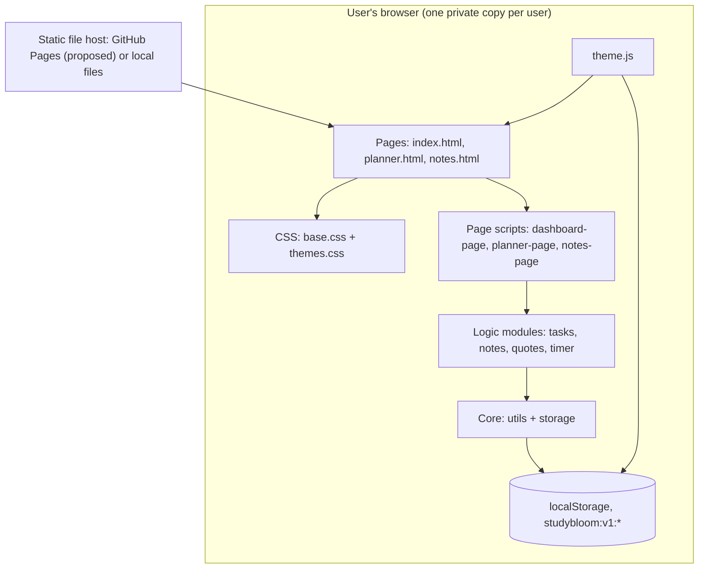
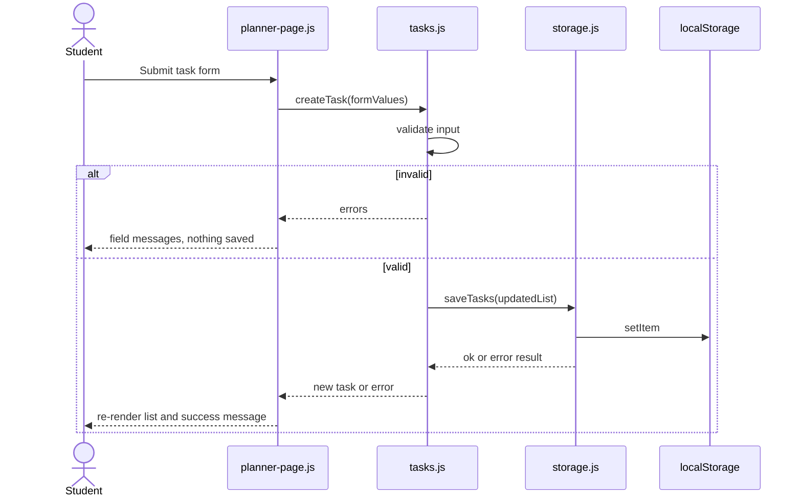
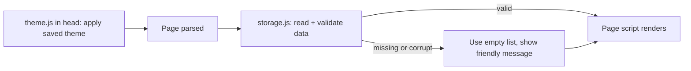
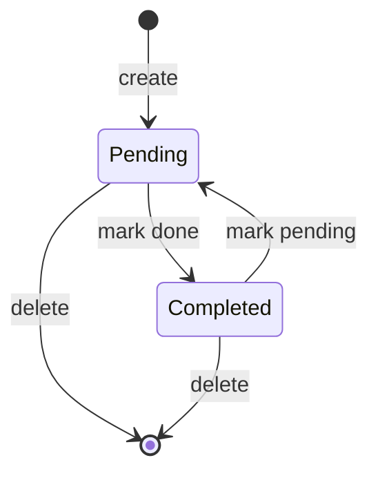
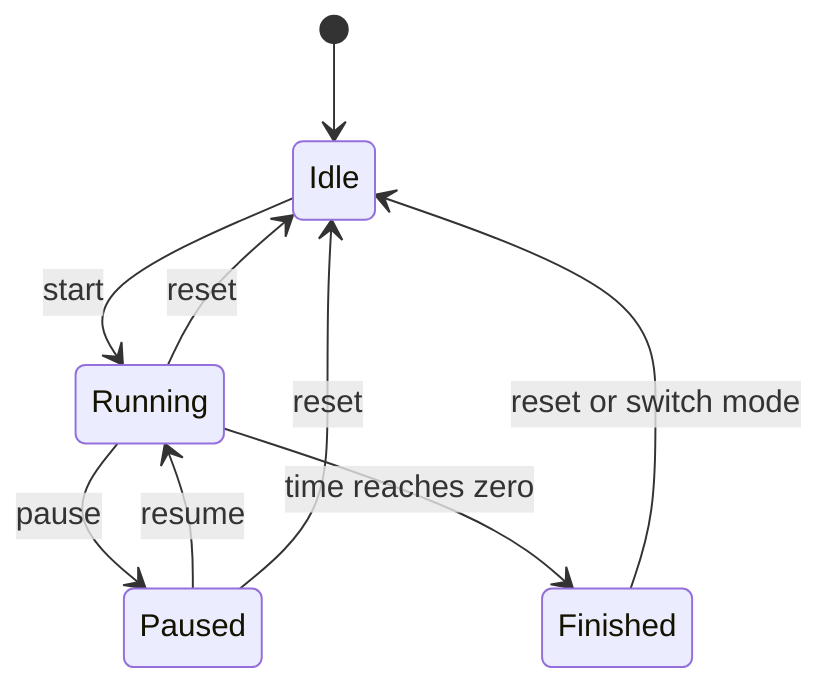

# StudyBloom — Architecture

**Version:** 0.1 (draft) · **Date:** 14 Oct 2026
**Related:** [PRD](PRD.md) · [TRD](TRD.md) · [appFlow](appFlow.md) · [database](database.md) · [design](design.md) · [Rules](Rules.md) · [phases](phases.md)

## 1. Overview

StudyBloom is a **static, client-side, multi-page website**. There is no server code. All logic runs in the browser and all data lives in the browser's `localStorage` (D3, D4, D5). The "server" is only a place that hands out files (GitHub Pages, proposed P-01).

**Style:** simple layered structure inside the browser (page scripts → logic modules → storage). No microservices, no framework, no build step.

**Why this is enough:** every approved requirement is satisfied by static files plus browser storage. Anything heavier (backend, database, state libraries) is unjustified by the requirements (Rules §3).

## 2. System diagram



## 3. Components and responsibilities

| Component | Responsibility | Inputs → Outputs | Reqs |
|---|---|---|---|
| **HTML pages** | Structure, landmarks, shared header/nav/footer markup, status region, CSP meta | — | FR-001, FR-026, SEC-06 |
| **`css/base.css`** | Layout, components, responsive rules; uses only theme variables for color | — | NFR-004 |
| **`css/themes.css`** | Four sets of color/shadow variables keyed by `data-theme` on `<html>` | — | FR-021 |
| **`js/theme.js`** | Loaded in `<head>`; applies saved theme **before first paint**; wires the selector; saves choice | theme id ↔ storage | FR-021, FR-022 |
| **`js/utils.js`** | Safe DOM helpers (`setText`, element builder), id generator, date helpers (today, format, add days), text helpers | — | NFR-001 |
| **`js/storage.js`** | The **only** code that touches `localStorage`: availability check, safe read/parse/validate, save with error result | arrays ↔ JSON | FR-024, NFR-006, SEC-02 |
| **`js/tasks.js`** | Task rules: validate, create/update/delete/toggle, sort, filter, overdue, stats, dashboard selections | form values → task data | FR-009–014, FR-003–005 |
| **`js/notes.js`** | Note rules: validate, CRUD, sort, search | form values → note data | FR-015–020 |
| **`js/quotes.js`** | Static quote list + `quoteForDay` | date → quote | FR-007 |
| **`js/timer.js`** | Timer logic (`computeRemaining`) and widget control | clicks → display | FR-023 |
| **`js/*-page.js`** | DOM only: read forms, call logic modules, render lists, show messages | DOM ↔ logic | all UI |

**Rule of separation:** logic modules never touch the DOM; page scripts never touch `localStorage` directly. This makes the logic unit-testable (TRD §10).

**Scripts and namespace (P-18):** each file attaches itself to `window.StudyBloom` (e.g., `StudyBloom.storage`). Load order per page: `theme.js` (in `<head>`), then at the end of `<body>`: `utils.js`, `storage.js`, needed logic modules, then the page script.

## 4. Data flows

### 4.1 Add a task


### 4.2 Page load


### 4.3 Task states


### 4.4 Timer states


## 5. Trust boundaries and error handling

| Boundary | Risk | Handling |
|---|---|---|
| User input → page | Injected HTML/script | Plain-text rendering only (SEC-01), CSP (SEC-06) |
| `localStorage` → app | Edited/corrupted/old data | Parse in `try/catch`, validate shape, drop bad records (SEC-02) |
| App → `localStorage` | Storage full or blocked | `saveX()` returns an error result; page shows a message and keeps the in-memory view (TC-26, TC-27) |
| Host → browser | Third-party content | None allowed (SEC-07) |
| Other tabs | Stale data when two tabs are open | Last write wins; each action re-reads storage before saving (known limitation) |

**Authorization:** not applicable; no accounts or roles (D3).

## 6. Proposed folder structure (Proposed, P-18)

```
studyBloom/                   ← project root (the website itself)
├── index.html                ← Home dashboard
├── planner.html              ← Study Planner
├── notes.html                ← Study Notes
├── css/
│   ├── base.css              ← layout + components (no hard-coded theme colors)
│   └── themes.css            ← four themes via CSS variables
├── js/
│   ├── theme.js              ← theme apply/save/selector (loaded in <head>)
│   ├── utils.js              ← safe DOM helpers, ids, dates
│   ├── storage.js            ← the only localStorage access
│   ├── tasks.js              ← task logic
│   ├── notes.js              ← note logic
│   ├── quotes.js             ← quote data + daily pick
│   ├── timer.js              ← timer logic + widget
│   ├── dashboard-page.js     ← Home UI
│   ├── planner-page.js       ← Planner UI
│   └── notes-page.js         ← Notes UI
├── assets/
│   └── favicon.svg           ← small icon (optional)
├── tests/
│   └── tests.html            ← browser-run unit tests (P-19)
├── docs/                     ← the eight Markdown documents (once the repo is created)
├── .gitignore
└── README.md                 ← short intro and run instructions (written in PH-07)
```

## 7. Architectural decisions and trade-offs

| ID | Decision | Alternative | Trade-off |
|---|---|---|---|
| AD-01 | Static multi-page site | Single-page app | Duplicated header markup on 3 pages (small) vs. simplicity |
| AD-02 | Logic/DOM/storage separated | One big script | A few more files vs. testability and learning clarity |
| AD-03 | Theme applied in `<head>` | Apply after load | Avoids a flash of the wrong theme |
| AD-04 | Timer computes from timestamps | Count down with a repeating tick | Stays accurate when a tab is in the background |
| AD-05 | Timer is a Home widget (P-02) | Separate page | No fourth nav item; timer resets if you leave Home |

## 8. Failure modes and resilience

- **Storage cleared:** app starts empty with friendly empty states; footer notice explains why (FR-026).
- **Storage disabled (private mode/blocked):** warning banner; app remains usable for the session only.
- **Corrupted JSON:** treated as empty; the bad value is not overwritten until the user saves new data (so nothing is silently destroyed more than necessary).
- **Old schema in future:** key version (`v1`) supports a future migration (database §7).
- **JavaScript disabled:** pages show a `<noscript>` message that the app needs JavaScript.
