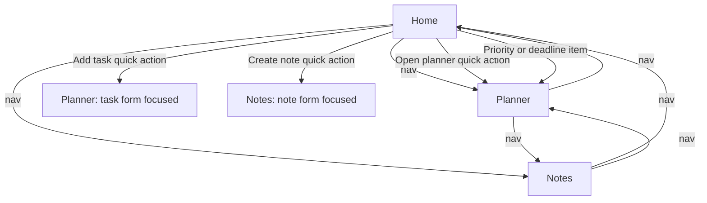

# StudyBloom — Application and User Flow

**Version:** 0.1 (draft) · **Date:** 14 Oct 2026
**Related:** [PRD](PRD.md) (requirement IDs) · [design](design.md) (visuals) · [database](database.md) (data rules) · [Architecture](Architecture.md)

This document describes **behavior and navigation**. Colors, spacing and component styling live in `design.md`. Items marked **(P-xx)** are proposals awaiting approval in the PRD.

## 1. Screen inventory

| Screen | File | Purpose |
|---|---|---|
| Home (dashboard) | `index.html` | Overview, priorities, deadlines, quote, timer, quick actions |
| Planner | `planner.html` | Create, view, edit, delete, complete tasks |
| Notes | `notes.html` | Create, view, edit, delete, search notes |

There is **no login, onboarding or settings screen** (D3). An About page is optional and not planned.

## 2. Navigation map

Deep links (P-18): `planner.html#new-task` and `notes.html#new-note` open the page and move focus to the first field of the form.

## 3. Elements shared by every page

| Element | Behavior | Reqs |
|---|---|---|
| **Header: logo + tagline** | Logo links to Home | FR-001 |
| **Navigation** (Home, Planner, Notes) | Links work; the current page is visibly marked and has `aria-current="page"`. Top bar on wide screens, bottom tab bar on phones (P-17) | FR-001, NFR-012 |
| **Theme selector** | Labeled dropdown with four options. Changing it applies the theme immediately, saves the choice, and works on all pages. If saving fails, theme still applies for this visit and a message is shown | FR-021, FR-022 |
| **Skip link** | "Skip to main content" is the first focusable element | NFR-005 |
| **Status area** | One `aria-live="polite"` region for success and error messages; messages disappear after a few seconds (success) or stay until fixed (errors) | FR-025 |
| **Storage warning banner** | Shown only if `localStorage` is unavailable: "Your browser is blocking saving. You can use StudyBloom, but nothing will be kept after you close this page." | NFR-006 |
| **Footer notice** (P-12) | "Your tasks and notes are saved only in this browser on this device. Clearing your browser data will erase them. Please don't store passwords or sensitive information." | FR-026 |
| **`<noscript>` message** | "StudyBloom needs JavaScript to work." | NFR-006 |

## 4. Screens

### 4.1 Home (`index.html`)

**Layout (top to bottom):** greeting + date → stat cards → quick actions → two lists (Today's priorities, Upcoming deadlines) → quote card → timer widget.

| Element | Trigger / source | Processing | Success result | Failure / empty | Reqs |
|---|---|---|---|---|---|
| Greeting + date | Page load | Time-of-day greeting (morning <12:00, afternoon <18:00, else evening) (P-21); date formatted for the user's locale | "Good morning! Today is Wednesday, 14 October 2026." | — | FR-002 |
| Stat cards (Total tasks, Completed, Notes) | Page load | Read tasks/notes from storage; count | Real numbers | No data → shows 0 with the empty state below | FR-003 |
| Quick action: **Add task** | Click | Navigate to `planner.html#new-task` | Form focused | — | FR-006 |
| Quick action: **Create note** | Click | Navigate to `notes.html#new-note` | Form focused | — | FR-006 |
| Quick action: **Open planner** | Click | Navigate to `planner.html` | Planner shown | — | FR-006 |
| **Today's priorities** (P-08) | Page load | Pending tasks with due date ≤ today (overdue first), sorted by P-07 rules, max 5; each item links to the Planner | Items shown with title, subject, priority, due label | No tasks at all → "No tasks yet. Add your first one!" + button. Tasks exist but none due → "Nothing due today. Nice and calm!" | FR-004, FR-008 |
| **Upcoming deadlines** (P-08) | Page load | Pending tasks with due date from tomorrow to today+7 days, by date, max 5 | Items shown with date | None → "No deadlines in the next 7 days." | FR-005, FR-008 |
| "View all" link | Click | Go to `planner.html` | | | FR-001 |
| **Quote card** (P-11) | Page load | Daily quote from the list by day-of-year; **Another quote** button picks a different one | Quote text shown | Empty list (should not happen) → hide card | FR-007 |
| **Timer widget** (P-02, P-03) | Buttons | See §5 | | | FR-023 |

Empty-state for **notes** on Home: if there are 0 notes the Notes stat card shows 0 and a small link "Write your first note" (to `notes.html#new-note`).

### 4.2 Planner (`planner.html`)

**Layout:** page title → task form card → filter tabs → task list. On wide screens the form sits beside the list (design §5).

**Task form fields:** Title (required), Subject (text, optional, default "General"), Due date (optional date picker), Priority (select Low / **Medium** / High, default Medium). Buttons: **Add task** (becomes **Save changes** while editing) and **Cancel** (shown only while editing).

| Action | Trigger | Validation | Processing | Success | Failure |
|---|---|---|---|---|---|
| **Add task** | Submit form | Title required after trimming, ≤100 chars; subject ≤30; due date empty or a real date; priority one of three (database §3) | Create task (id, timestamps), save, re-render | "Task added." form cleared, focus back to Title | Inline message next to the field; nothing saved. If saving fails → "Could not save. Your browser storage may be full or blocked." |
| **Mark done / pending** | Checkbox (or button) on a task | — | Toggle `completed`, save, re-render | Task moves/looks completed (strikethrough + "Done" label + check mark); Home counts update on next visit | Save error message; checkbox reverts |
| **Edit** | Click **Edit** | — | Fill the form with the task, change heading to "Edit task", scroll/focus form | Form in edit mode | If the task no longer exists (e.g., deleted in another tab) → message "That task no longer exists." |
| **Save changes** | Submit in edit mode | Same as Add | Update fields + `updatedAt`, save | "Task updated." edit mode closed | As Add |
| **Cancel edit** | Click | — | Clear form, leave edit mode | Original task unchanged | — |
| **Delete** | Click **Delete** | — | `confirm("Delete this task? This cannot be undone.")`; on OK remove and save (P-09) | "Task deleted." | Cancel → nothing changes |
| **Filter tabs** (P-06) | Click All / Pending / Completed | — | Show the matching tasks; the selected tab is marked; selection is not saved | List updates | Empty filter → "No completed tasks yet." / "No pending tasks. Great job!" |

**Task item shows:** title, subject chip, due date (with label "Overdue" or "Due today" when relevant), priority chip (text + symbol, not color only), completed state, Edit and Delete buttons.

**Sort (P-07):** pending first; within pending by due date ascending (no date last), then priority high → low, then oldest created; completed tasks after, most recently updated first.

**Empty state:** "No tasks yet. Add your first task above to get started."

### 4.3 Notes (`notes.html`)

**Layout:** page title → note form card → search box → notes grid (1/2/3 columns by width, design §5).

**Note form fields:** Title (required), Subject/category (text, optional, default "General"), Content (multi-line text, required). Buttons: **Save note** / **Save changes** and **Cancel** (edit mode).

| Action | Trigger | Validation | Processing | Success | Failure |
|---|---|---|---|---|---|
| **Save note** | Submit | Title required ≤100; content required ≤5000; subject ≤30 | Create note, save, re-render | "Note saved." form cleared | Inline field messages; save-failure message as in Planner |
| **View** | Page load / after changes | — | Notes sorted newest-updated first (P-23); each card shows title, subject chip, date ("Created …" or "Updated …"), content with a 3-line preview and **Show more / Show less** for long content | Notes visible | Empty → "No notes yet. Write your first note above." |
| **Edit** | Click **Edit** | — | Fill the form, focus Title | Edit mode | Missing note → message |
| **Delete** | Click **Delete** | — | Confirm dialog, then remove and save | "Note deleted." | Cancel → no change |
| **Search** | Type in the search box (live) | — | Case-insensitive match of the text in title **or** content; combined with nothing else; clear button resets | Matching notes shown, "3 notes found" announced politely | None → "No notes match 'xyz'." with a Clear search button |

Search text is only used for comparing; it is never inserted as HTML. The search term shown in the "no match" message is inserted as plain text.

## 5. Study timer (Home widget) (P-02, P-03)

- Modes: **Focus (25:00)** and **Break (5:00)**. Mode buttons switch modes and reset the clock.
- Controls: **Start** (becomes **Pause** while running; after pausing it resumes), **Reset**.
- Display: large `MM:SS`, current mode name, and the browser tab title shows the remaining time while running.
- At zero: clock stops, message "Focus session complete! Time for a break." (or "Break over! Ready to focus?"), mode suggestion highlighted but **not auto-started**. No sound or notifications in the MVP.
- Time is computed from real clock timestamps so it stays correct when the tab is in the background (AD-04).
- Leaving the Home page stops and discards the timer (not saved). Disclosed in a small hint under the timer.

## 6. End-to-end journeys

**J-1 First visit:** Home shows 0/0/0, friendly empty states, quote, timer, footer notice → student clicks **Add task** → Planner form focused → saves first task → Home now shows it in Today's priorities (if due) or counts.

**J-2 Daily use:** open Home → see priorities → click item → Planner → tick task done → return Home, completed count increased.

**J-3 Notes:** Create note → type in search to find it by a word in the content → edit → delete with confirmation.

**J-4 Theme:** change theme in header → whole page changes → navigate to another page → same theme → refresh → still the same.

**J-5 Data lost:** user clears browser data → app opens with empty states, no errors.

**J-6 Alternate paths:** invalid form → inline messages; save failure → error message and no silent loss; delete cancelled → nothing changes; corrupted storage → treated as empty with a message (TC-26).

## 7. States checklist

| State | Where handled |
|---|---|
| Empty | Home lists, Planner list, Notes grid, filters, search |
| Error | Form validation, save failure, storage blocked, corrupted data |
| Success | Status area messages (add/update/delete/save) |
| Disabled | Buttons are never left "dead": Start/Pause/Reset always valid; Cancel shown only in edit mode |
| Loading | Not needed (local data is instant) |

## 8. Requirement coverage

| Screen/flow | Reqs |
|---|---|
| Shared elements | FR-001, FR-021, FR-022, FR-026, NFR-005, NFR-006, NFR-012 |
| Home | FR-002–FR-008, FR-023 |
| Planner | FR-009–FR-014, FR-025 |
| Notes | FR-015–FR-020, FR-025 |
| Persistence | FR-024 (no dedicated screen; see [database](database.md)) |
