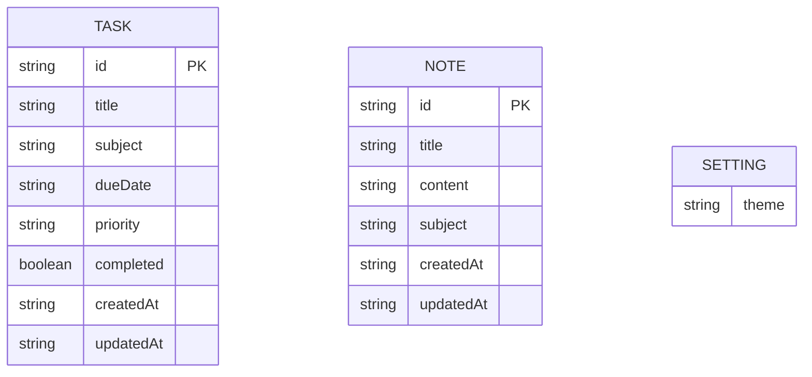

# StudyBloom — Data Storage Design

**Version:** 0.1 (draft) · **Date:** 14 Oct 2026
**Related:** [PRD](PRD.md) · [TRD](TRD.md) · [Architecture](Architecture.md) · [appFlow](appFlow.md)

## 1. Summary

StudyBloom has **no database** (D3). Data is kept in the browser's `localStorage` (D5) as JSON text. This document is the **single source of truth** for the data model, validation rules and defaults.

**Plain-language limits of this choice (Confirmed context):**
- Data stays in **one browser on one device**. Phone and laptop do **not** share data.
- If the user clears site data (or uses private/incognito mode), the data is erased.
- Other people cannot see your data and you cannot see theirs (each browser is separate), but anyone using the same browser profile can.
- Storage space is limited (a few MB), which is plenty for personal tasks and notes.

## 2. Storage keys

All keys are prefixed so they cannot clash with other sites on the same host (SEC-08).

| Key | Value | Notes |
|---|---|---|
| `studybloom:v1:tasks` | JSON array of Task objects | Missing key = empty list |
| `studybloom:v1:notes` | JSON array of Note objects | Missing key = empty list |
| `studybloom:v1:theme` | Plain string theme id | One of `soft-pastel`, `lavender-white`, `dark-academia`, `sage-green`; anything else → default `soft-pastel` |

Not stored: quotes (static code, `quotes.js`), timer state (P-03), filter/search selections.

## 3. Entities

No relationships exist between tasks and notes. A **subject** is just a text label on each record, not a separate entity (P-04).



### 3.1 Task (`studybloom:v1:tasks`)

| Field | Type | Required | Rule / default | Status |
|---|---|---|---|---|
| `id` | string | yes | Unique (UUID or timestamp+random fallback); never edited | Proposed |
| `title` | string | yes | Trimmed, 1–100 chars | Required by brief; limit P-10 |
| `subject` | string | no | Trimmed, 0–30 chars; empty → `"General"` | P-04 |
| `dueDate` | string | no | `""` or valid calendar date `YYYY-MM-DD` (must be a real date; past dates allowed) | P-05 |
| `priority` | string | yes | `"low"`, `"medium"` or `"high"`; default `"medium"` | Brief |
| `completed` | boolean | yes | Default `false` | Brief |
| `createdAt` | string | yes | ISO 8601 UTC timestamp, set once | Proposed |
| `updatedAt` | string | yes | ISO 8601 UTC timestamp, changed on every edit or toggle | Proposed |

### 3.2 Note (`studybloom:v1:notes`)

| Field | Type | Required | Rule / default | Status |
|---|---|---|---|---|
| `id` | string | yes | As Task | Proposed |
| `title` | string | yes | Trimmed, 1–100 chars | Brief; P-10 |
| `content` | string | yes | Trimmed, 1–5000 chars; line breaks preserved | Brief; P-10 |
| `subject` | string | no | Trimmed, 0–30 chars; empty → `"General"` | P-04 |
| `createdAt` | string | yes | ISO 8601 UTC timestamp | Proposed |
| `updatedAt` | string | yes | ISO 8601 UTC timestamp | Proposed |

### 3.3 Derived values (never stored)

- **Overdue:** `completed === false` **and** `dueDate !== ""` **and** `dueDate < today` (today = the user's local date as `YYYY-MM-DD`).
- **Due today:** pending and `dueDate === today`.
- **Stats:** total tasks = array length; completed = count where `completed`; notes = array length.
- **Today's priorities / Upcoming:** see appFlow §4.1 (P-08).

## 4. Validation on read (untrusted data)

When loading, `storage.js` must:
1. Return an empty list if the key is missing.
2. Wrap `JSON.parse` in `try/catch`; on failure treat the data as empty and tell the user (TC-26).
3. Require the parsed value to be an array.
4. Keep only records that pass the field rules above (correct types, valid enums, valid date, lengths within limits); silently drop the rest and report how many were skipped.
5. Ensure ids are unique; drop duplicates.
6. **Not overwrite** the stored value merely by loading. Corrupt data is replaced only when the user next saves.

## 5. Ownership, access and deletion

- **Owner:** whoever uses that browser profile on that origin. No sharing, no roles (D3).
- **Delete:** a deleted task or note is **permanently removed** (no recycle bin) after confirmation (P-09).
- **Retention:** kept until the user deletes it or clears browser data. No automatic expiry.
- **Sensitive data:** the app is not designed for sensitive information; the footer says so (FR-026). No personal data such as names or emails is collected.
- **Backup:** none in the MVP; export/import is a Version 2 candidate.

## 6. Capacity and failure handling

- `setItem` can throw (storage full, disabled). `storage.js` returns `{ ok: false, error }`; page scripts show a message and do not pretend the data was saved.
- Note content is capped at 5000 characters (P-10) so a few hundred notes stay well within typical limits.
- Concurrent tabs: last write wins; every write re-reads the latest stored list first and applies one change to it (reduces accidental overwrites).

## 7. Versioning and migration

The key prefix `v1` is the schema version. If fields change later, a new prefix (`v2`) is introduced and a one-time migration reads `v1` data, converts it, writes `v2`, and keeps `v1` until the conversion succeeds. No migration exists in the MVP. No seed/demo data is created (the dashboard must show real data only, per the brief).

## 8. Example records (illustrative only)

```json
{
  "id": "c1f3a9e2-4d6b-4a1e-9b52-0e7d3f1a8c10",
  "title": "Finish chemistry lab report",
  "subject": "Chemistry",
  "dueDate": "2026-10-16",
  "priority": "high",
  "completed": false,
  "createdAt": "2026-10-14T05:10:00.000Z",
  "updatedAt": "2026-10-14T05:10:00.000Z"
}
```

```json
{
  "id": "9a2b7d10-55e3-4c78-8f0a-2b6c4d9e1f33",
  "title": "Cell division summary",
  "content": "Mitosis has four stages...\nMeiosis makes gametes.",
  "subject": "Biology",
  "createdAt": "2026-10-14T05:12:00.000Z",
  "updatedAt": "2026-10-14T05:12:00.000Z"
}
```

## 9. Common operations (pseudo-code)

```
tasksToday     = tasks where completed == false and dueDate != "" and dueDate <= today
upcoming       = tasks where completed == false and dueDate > today and dueDate <= today + 7 days
notesMatching  = notes where lower(title) or lower(content) contains lower(searchText)
```

## 10. Requirement coverage

FR-003, FR-009–FR-013, FR-015–FR-020, FR-022, FR-024, NFR-006, SEC-02, SEC-08.
