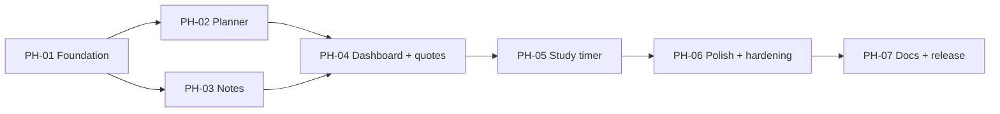

# StudyBloom — Implementation Roadmap (phases)

**Version:** 0.1 (draft) · **Date:** 14 Oct 2026
**Related:** [PRD](PRD.md) · [TRD](TRD.md) (test catalog TC-xx) · [Architecture](Architecture.md) · [appFlow](appFlow.md) · [database](database.md) · [design](design.md) · [Rules](Rules.md)

> **Status:** planned work only. Nothing here has been implemented or tested. **No coding starts until the owner explicitly says so (D9).** Task status below is `Not started` until verified.

## 1. Overview and sequencing

**Approach:** build the shared foundation first (storage, themes, layout), then one feature page at a time, then polish, then release. Each phase ends with the same quality gate (§2).

**Phase count (P-22, OQ-03):** The brief mentions "eight project phases" defined elsewhere, but only the documentation prompt was provided. That prompt asks for an adaptive roadmap sized to the project, so **seven phases** are proposed. If the owner supplies a different eight-phase list, this file will be remapped.

**Proposed pacing (a guide, not a promise):**

| Day | Phases |
|---|---|
| Day 1 | PH-01, PH-02, PH-03 |
| Day 2 | PH-04, PH-05, PH-06 |
| Day 3 (buffer) | PH-07, fixes, anything that slipped |

**Free-plan tip (Rules §10):** work on one phase per chat session, ask for complete files, and ask for a short handover note at the end.

## 2. Standard Phase Gate (single definition, applies at the end of every phase)

1. **Unit tests:** open `tests/tests.html` in a browser; all tests for logic added so far pass. Record the pass/fail counts.
2. **Integration checks:** perform the phase's manual walk-throughs in a real browser (UI → storage → **refresh** → data still correct).
3. **Regression:** re-run every applicable item in the Regression Suite (§3).
4. **Acceptance:** verify each task's acceptance criteria and the test cases (TC-xx) listed for the phase.
5. **Quick reviews:** security (R-14 to R-17), accessibility (keyboard, labels), error handling (empty/invalid/failed-save states).
6. **Fix** in-scope defects, rerun affected tests.
7. **Update docs** and the task status in this file.
8. **Record** results in the Phase Log (§8) using **Passed / Failed / Not tested / Blocked**. If a test can't be run, write why and what follow-up is needed.

**Rule:** the next dependent phase does not begin until the exit criteria are met.

## 3. Regression Suite (grows as phases complete)

| ID | Check | Introduced |
|---|---|---|
| REG-01 | All nav links work on every page; current page marked (TC-29) | PH-01 |
| REG-02 | Theme switch works for all four themes and persists after refresh (TC-23, TC-24) | PH-01 |
| REG-03 | Footer notice present on every page (TC-34) | PH-01 |
| REG-04 | No console errors; no external requests (TC-35, TC-36) | PH-01 |
| REG-05 | Planner: add, edit, toggle, delete, persistence (TC-01 to TC-08, TC-25) | PH-02 |
| REG-06 | Notes: add, edit, delete, search, persistence (TC-09 to TC-17, TC-25) | PH-03 |
| REG-07 | Home numbers and lists match saved data (TC-18 to TC-22, TC-37) | PH-04 |
| REG-08 | Timer works (TC-33) | PH-05 |
| REG-09 | XSS payload test across all inputs (TC-28) | PH-02 (extended in PH-03) |
| REG-10 | Corrupted/missing storage handled (TC-26, TC-27) | PH-01 (extended each phase) |
| REG-11 | Widths 320/375/768/1280 without overflow (TC-30) | PH-01 (extended each phase) |

## 4. Phases and tasks

### PH-01 — Foundation and shared layout
- **Objective:** project skeleton, themes, shared header/footer, safe storage layer, test page.
- **Reqs covered:** FR-001, FR-021, FR-022, FR-024 (storage layer), FR-026, NFR-001, NFR-002, NFR-004, NFR-006, NFR-009, NFR-012.
- **Prerequisites:** owner authorizes implementation; Open questions OQ-02 and OQ-04 answered (or assumptions accepted).
- **Deliverables:** folder structure, three page shells, `base.css`, `themes.css`, `theme.js`, `utils.js`, `storage.js`, `tests/tests.html`.
- **Exit criteria:** pages open and navigate; four themes switch and persist; footer notice and CSP present; storage functions unit-tested; REG-01 to REG-04, REG-10, REG-11 pass.

| Task | Description | Acceptance criteria | Files | Reqs |
|---|---|---|---|---|
| TASK-001 | Create folder structure, empty files, `.gitignore` (enabling work) | Structure matches Architecture §6 | all | NFR-009 |
| TASK-002 | `utils.js`: safe text/element helpers, id generator, date helpers (today, format, add days, valid date) | Unit tests for date helpers and id uniqueness pass | `js/utils.js` | NFR-001, CON-4 |
| TASK-003 | `storage.js`: availability check, safe load with validation (database §4), save with error results, namespaced keys | Corrupt, missing and wrong-shape data tests pass; failed save returns an error result | `js/storage.js` | FR-024, NFR-006 |
| TASK-004 | `themes.css` with four token sets (design §2) and `theme.js` (apply in `<head>`, save, selector) | TC-23, TC-24 pass | `css/themes.css`, `js/theme.js` | FR-021, FR-022 |
| TASK-005 | `base.css`: layout, components, responsive rules, focus styles, reduced motion | No horizontal overflow at 320px; uses only tokens | `css/base.css` | NFR-004, NFR-005 |
| TASK-006 | Shared header/nav/footer/status/noscript/CSP in the three page shells; skip link; storage-warning banner | TC-29, TC-34 pass | `*.html` | FR-001, FR-026, SEC-06 |
| TASK-007 | `tests/tests.html` with a small assert helper; tests for `utils` and `storage` | Page shows total passed/failed | `tests/tests.html` | P-19 |
| TASK-008 | Check whether the CSP works when opening files directly (TRD §12) and record the result | Outcome written in Phase Log | — | CON-1 |
| TASK-009 | Run Phase Gate for PH-01 | Gate recorded | — | — |

### PH-02 — Planner (tasks)
- **Objective:** full task management.
- **Reqs covered:** FR-009 to FR-014, FR-025, FR-024 (tasks), NFR-001.
- **Prerequisites:** PH-01 exit criteria met.
- **Deliverables:** `tasks.js`, `planner-page.js`, planner markup/styles.
- **Exit criteria:** TC-01 to TC-08, TC-25 (tasks), TC-28 (task fields) pass; REG-01 to REG-04 still pass.

| Task | Description | Acceptance criteria | Files | Reqs |
|---|---|---|---|---|
| TASK-010 | Planner page markup: task form, filter tabs, list, empty state | Elements match appFlow §4.2 | `planner.html` | FR-009, FR-014 |
| TASK-011 | `tasks.js`: `validateTask`, create, update, delete, toggle, sort (P-07), filter, `isOverdue` | Unit tests cover valid/invalid input, sort order, overdue, filters | `js/tasks.js` | FR-009–FR-014 |
| TASK-012 | Render list safely: completed vs pending look, priority chips, overdue/due-today labels | TC-03, TC-04 pass | `js/planner-page.js` | FR-010 |
| TASK-013 | Form handling: validation messages, success messages, edit mode, cancel | TC-02, TC-05 pass | `js/planner-page.js` | FR-011, FR-025 |
| TASK-014 | Delete with confirmation, toggle, filters, `#new-task` deep link focus | TC-06, TC-07, TC-08 pass | `js/planner-page.js` | FR-012–FR-014 |
| TASK-015 | XSS and persistence checks for tasks | TC-28 (tasks), TC-25 pass | — | NFR-001, FR-024 |
| TASK-016 | Run Phase Gate for PH-02 | Gate recorded | — | — |

### PH-03 — Notes
- **Objective:** full note management with search.
- **Reqs covered:** FR-015 to FR-020, FR-025, FR-024 (notes), NFR-001.
- **Prerequisites:** PH-01 exit criteria met (can follow PH-02 or run in parallel).
- **Deliverables:** `notes.js`, `notes-page.js`, notes markup/styles.
- **Exit criteria:** TC-09 to TC-17, TC-25 (notes), TC-28 (notes) pass; REG-01 to REG-05 still pass.

| Task | Description | Acceptance criteria | Files | Reqs |
|---|---|---|---|---|
| TASK-017 | Notes page markup: form, search box, grid, empty state | Matches appFlow §4.3 | `notes.html` | FR-015, FR-019 |
| TASK-018 | `notes.js`: `validateNote`, create, update, delete, sort (P-23), `searchNotes` | Unit tests cover validation, sort, search by title/content, case-insensitive, no match | `js/notes.js` | FR-015–FR-019 |
| TASK-019 | Render notes safely: subject chip, date, preview with Show more/less | TC-11, TC-17 pass | `js/notes-page.js` | FR-016, FR-020 |
| TASK-020 | Form handling: validation, edit mode, delete confirmation, `#new-note` deep link | TC-09, TC-10, TC-12, TC-13 pass | `js/notes-page.js` | FR-017, FR-018, FR-025 |
| TASK-021 | Live search with "no results" state and Clear button | TC-14, TC-15, TC-16 pass | `js/notes-page.js` | FR-019 |
| TASK-022 | XSS and persistence checks for notes | TC-28 (notes), TC-25 pass | — | NFR-001, FR-024 |
| TASK-023 | Run Phase Gate for PH-03 | Gate recorded | — | — |

### PH-04 — Dashboard and quotes
- **Objective:** Home page driven by real data.
- **Reqs covered:** FR-002 to FR-008.
- **Prerequisites:** PH-02 and PH-03 exit criteria met.
- **Deliverables:** `quotes.js`, `dashboard-page.js`, Home markup/styles.
- **Exit criteria:** TC-18 to TC-22, TC-37 pass; REG-01 to REG-06 still pass.

| Task | Description | Acceptance criteria | Files | Reqs |
|---|---|---|---|---|
| TASK-024 | Home markup: greeting/date, stat cards, quick actions, two lists, quote card, timer placeholder area | Matches appFlow §4.1 | `index.html` | FR-001–FR-008 |
| TASK-025 | Greeting (time of day) and formatted date | TC-37 pass | `js/dashboard-page.js` | FR-002 |
| TASK-026 | `computeStats`, `selectTodayPriorities`, `selectUpcoming` + unit tests; render stats and lists | TC-18, TC-19 pass | `js/tasks.js`, `js/dashboard-page.js` | FR-003–FR-005 |
| TASK-027 | Quick actions and links (deep links work) | TC-21 pass | `index.html` | FR-006 |
| TASK-028 | `quotes.js` (~25 original, unattributed quotes), `quoteForDay`, "Another quote" button + unit test | TC-22 pass | `js/quotes.js` | FR-007 |
| TASK-029 | Empty states for all Home areas | TC-20 pass | `js/dashboard-page.js` | FR-008 |
| TASK-030 | Run Phase Gate for PH-04 | Gate recorded | — | — |

### PH-05 — Study timer
- **Objective:** Pomodoro timer on Home (Should item; cut only with owner approval, OQ-05).
- **Reqs covered:** FR-023.
- **Prerequisites:** PH-04 exit criteria met.
- **Deliverables:** `timer.js`, timer widget styles.
- **Exit criteria:** TC-33 passes; REG-01 to REG-07 still pass.

| Task | Description | Acceptance criteria | Files | Reqs |
|---|---|---|---|---|
| TASK-031 | Timer markup and styles in the Home widget area | Matches appFlow §5, readable in all themes | `index.html`, `css/base.css` | FR-023 |
| TASK-032 | `computeRemaining` (timestamp based) + unit tests; start/pause/resume/reset; focus/break modes | TC-33 start/pause/reset pass; accurate after switching tabs (manual) | `js/timer.js` | FR-023 |
| TASK-033 | Finish message, tab-title update, no auto-start, hint that leaving the page resets | TC-33 finish pass | `js/timer.js` | FR-023 |
| TASK-034 | Run Phase Gate for PH-05 | Gate recorded | — | — |

### PH-06 — Polish and hardening
- **Objective:** make it accessible, secure, resilient and responsive on real devices.
- **Reqs covered:** NFR-001 to NFR-006, NFR-012, FR-026.
- **Prerequisites:** PH-05 (or PH-04 if the timer is deferred) exit criteria met.
- **Exit criteria:** TC-26 to TC-32, TC-34 to TC-36 pass; all regression checks pass.

| Task | Description | Acceptance criteria | Reqs |
|---|---|---|---|
| TASK-035 | Contrast check of all four themes with a contrast checker; adjust tokens and update `design.md` | TC-32 pass; any changed values recorded | NFR-005 |
| TASK-036 | Responsive review at 320/375/768/1280 px and on a real phone | TC-30 pass | NFR-004 |
| TASK-037 | Accessibility pass: keyboard-only use, labels, focus order, live-region messages, reduced motion; optionally Lighthouse accessibility audit | TC-31 pass; audit results recorded as run | NFR-005 |
| TASK-038 | Security pass: search code for forbidden APIs (R-14), run XSS payloads everywhere, confirm no inline scripts/styles, no secrets, no external requests | TC-28, TC-36 pass | NFR-001, NFR-002 |
| TASK-039 | Reliability pass: corrupt/missing/blocked storage, storage-full message | TC-26, TC-27, TC-35 pass | NFR-006 |
| TASK-040 | Review all wording (empty states, errors, footer notice) for clarity | Texts match appFlow | FR-025, FR-026 |
| TASK-041 | Run Phase Gate for PH-06 | Gate recorded | — |

### PH-07 — Documentation and release
- **Objective:** finalize docs, put the project on GitHub and (if approved) GitHub Pages, hand over.
- **Reqs covered:** NFR-009, NFR-010, NFR-011; enabling work.
- **Prerequisites:** PH-06 exit criteria met; OQ-01 and OQ-06 answered.
- **Exit criteria:** repository pushed (owner-confirmed), live link tested on phone and laptop, handover report written.

| Task | Description | Acceptance criteria | Reqs |
|---|---|---|---|
| TASK-042 | Full regression: every TC-xx marked Passed/Failed/Not tested/Blocked | Results table complete | all |
| TASK-043 | Update docs to match the final build; write `README.md` (what it is, how to run, limits) | Docs consistent; no unverified claims | NFR-009 |
| TASK-044 | Pre-commit check: secrets scan, file list review, `.gitignore` (Rules §9) | Owner confirms clean | SEC-04 |
| TASK-045 | Guide the owner through `git init`, first commit, GitHub repo creation, push | Owner confirms the push worked | NFR-010 |
| TASK-046 | Enable GitHub Pages (if P-01 approved); open the live URL on a phone and a laptop; repeat key tests | Live URL works; relative paths OK | P-01 |
| TASK-047 | Final handover report (features, stack, files, test results, limitations, run instructions, Git status, future ideas kept separate) | Report delivered | NFR-009 |

## 5. Requirement-to-task traceability

| Requirement | Tasks |
|---|---|
| FR-001 | TASK-006, 024 |
| FR-002 | TASK-025 |
| FR-003–FR-005 | TASK-026 |
| FR-006 | TASK-027 |
| FR-007 | TASK-028 |
| FR-008 | TASK-029 |
| FR-009–FR-014 | TASK-010 to 014 |
| FR-015–FR-020 | TASK-017 to 021 |
| FR-021, FR-022 | TASK-004 |
| FR-023 | TASK-031 to 033 |
| FR-024 | TASK-003, 015, 022 |
| FR-025 | TASK-013, 020, 040 |
| FR-026 | TASK-006, 040 |
| NFR-001, NFR-002 | TASK-002, 038 |
| NFR-004 | TASK-005, 036 |
| NFR-005 | TASK-005, 035, 037 |
| NFR-006 | TASK-003, 039 |
| NFR-009–NFR-011 | TASK-001, 043, 045, 047 |
| NFR-012 | TASK-006, 042 |
| NFR-003, NFR-007, NFR-008 | Verified in TASK-038, 036 and 042 (no dedicated build task) |

## 6. Task and phase status

All tasks (TASK-001 to TASK-047) and phases (PH-01 to PH-07): **Not started.**

## 7. Open blockers

| ID | Blocker | Blocks |
|---|---|---|
| OQ-04 | Approval of proposals P-01 to P-23 (batch or individually) | PH-01 start |
| OQ-02 | Confirm "Minimal Academic" is replaced by "Lavender & White" | PH-01 (themes) |
| OQ-03 | Confirm seven-phase roadmap (or supply the eight-phase list) | Whole roadmap |
| OQ-05 | May Should items be deferred if time runs short? | PH-04 to PH-05 decisions |
| OQ-01, OQ-06 | Hosting approval; GitHub username and repository name | PH-07 only |

## 8. Phase Log (fill in as work happens)

| Phase | Date | Unit tests (pass/fail counts) | Integration | Regression | Issues / follow-ups | Result |
|---|---|---|---|---|---|---|
| PH-01 | | | | | | Not started |
| PH-02 | | | | | | Not started |
| PH-03 | | | | | | Not started |
| PH-04 | | | | | | Not started |
| PH-05 | | | | | | Not started |
| PH-06 | | | | | | Not started |
| PH-07 | 2026-10-14 | 0/0 | Manual walkthrough pending | Pending | None | In progress |
